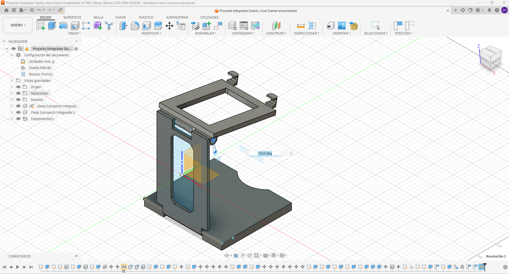
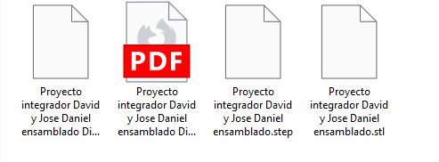
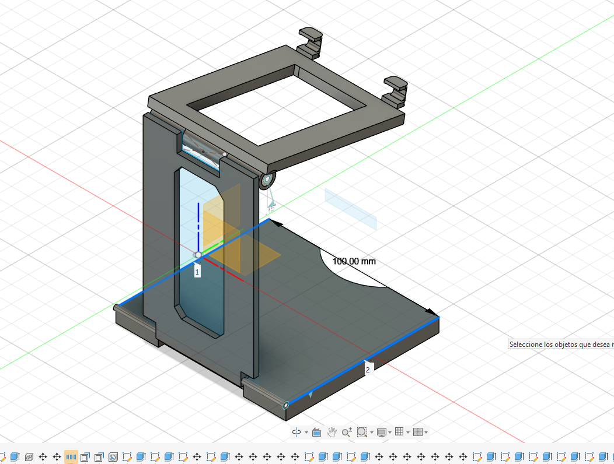

# Ficha de registro: Laboratorio Integrador II-B

**Curso:** ICT401 – Dibujo Técnico Asistido por Computadora
**Semana:** 16
**Laboratorio:** Integrador II-B
**Valor del laboratorio:** 10 %
**Estudiante o equipo:** Picon, David
**Proyecto:** Soporte ajustable para celular
**Fecha:** 05 de noviembre de 2026
**Versión inicial:** `nombre_proyecto_v__`
**Versión evaluada:** `nombre_proyecto_v__`

## Propósito y alcance

Esta ficha registra la evidencia del Laboratorio Integrador II-B: integración del modelo, ensamblaje, documentación, exportaciones, tolerancias introductorias y control dimensional básico.

La ficha **no sustituye la entrega de la Fase 4 del Proyecto Integrador**, cuyo valor oficial es 7 % y cuyos requisitos se definen en su propia rúbrica. Algunas evidencias pueden reutilizarse si cumplen ambos propósitos, pero deben conservarse separados el registro del laboratorio y la entrega de la fase.

No se evalúan mediante esta ficha la fabricación física, la metrología avanzada, los procesos completos de manufactura ni la presentación final de la Semana 17.

## Instrucciones

1. Complete la ficha durante las cuatro lecciones.
2. Registre la versión exacta del proyecto utilizada.
3. Conserve una copia de respaldo antes de modificar o exportar.
4. Registre el propósito, formato y comprobación de cada archivo de salida.
5. No invente tolerancias cuando no estén indicadas.
6. Cada medición debe incluir característica, unidad, método y limitación.
7. Use nombres o rutas verificables para las evidencias.

Los textos que comienzan con **Ejemplo:** muestran el nivel de detalle esperado. Sustitúyalos por los datos reales de su proyecto; no los copie como resultados propios.

### Ruta general en Fusion

1. Abra el **Data Panel**, localice el proyecto y abra el diseño vigente.
2. En el **Browser**, confirme componentes, cuerpos y el componente raíz.
3. Revise **Document Settings > Units** y anote las unidades activas.
4. Para el plano, abra el **Drawing** correspondiente y revise sus hojas.
5. Para medir, utilice **Inspect > Measure** y seleccione caras, aristas, puntos o diámetros.
6. Para exportar, utilice **File > Export** cuando el formato esté disponible. Para STL, seleccione el cuerpo o componente y use **Save As Mesh**.
7. Si una orden tiene otro nombre, use el buscador de comandos y registre la orden equivalente.

## Lección 1. Auditoría del proyecto y documentación

| Elemento | Registro |
|---|---|
| Archivo o enlace principal | Proyecto Integrador – Soporte ajustable para celular, Autodesk Fusion 360. |
| Versión revisada | Versión correspondiente a la Fase 4 del Proyecto Integrador.|
| Fecha de la versión | 4/11/26. |
| Unidades del proyecto | Milímetros (mm), utilizados para el diseño y dimensionamiento de las piezas. |
| Plano o Drawing utilizado | Drawing del Proyecto Integrador, Fase 4, compuesto por cuatro hojas de documentación técnica. |
| Ensamblaje utilizado, si corresponde | Ensamblaje del soporte ajustable para celular, formado por la base inferior, el soporte central y la pieza superior inclinable. |
| Lista básica de componentes, si corresponde | Lista de tres componentes principales, con una unidad de cada pieza. |
| Ubicación del respaldo inicial |carpeta de David Picon en fusion |
| Problema prioritario encontrado | Necesidad de comprobar que el modelo tridimensional, el ensamblaje y los planos técnicos correspondan a la misma versión, verificando dimensiones, unidades y documentación antes de las exportaciones finales. |

### Revisión de coherencia

|| Control | Sí | No | N.A. | Evidencia o corrección |
|---|:---:|:---:|:---:|---|
| El modelo y la documentación corresponden a la misma versión. | [x] | [ ] | [ ] | Se dispone del modelo y la documentación de la Fase 4. Falta confirmar el número de versión y su correspondencia exacta. |
| El plano contiene las vistas, cotas y datos que corresponden. | [x] | [ ] | [ ] | Los planos de la Fase 4 incluyen vistas y cotas de las piezas. Se documentaron dimensiones como 100 × 90 mm para la base inferior, 50 × 110 mm para el soporte central y 70 × 100 mm para la pieza superior. |
| El cajetín o identificación está completo según la plantilla. | [x] | [ ] | [ ] | La documentación contiene cajetines. Falta verificar que todos incluyan correctamente título, autores, fecha, escala y unidades. |
| La lista coincide con el ensamblaje, cuando corresponde. | [x] | [ ] | [ ] | La documentación registra tres componentes principales: base inferior, soporte central y marco superior, con una unidad de cada uno. |
| La orientación y la escala son coherentes. | x ] | [ ] | [ ] | Se dispone de cuatro hojas de planos técnicos. Falta comprobar la escala indicada y la orientación de las vistas en cada hoja. |

**Captura del estado inicial:** `evidencias/S16_E1_Estado_Inicial.png`  
**Corrección prioritaria antes de exportar:**

## Lección 2. Exportaciones y comprobación de archivos

En Fusion, seleccione primero el objeto correcto en el **Browser**. No exporte todo el proyecto si solo se solicita una pieza o un componente.

| Formato | Propósito | Configuración relevante | Archivo generado | Comprobado |
|---|---|---|---|:---:|
| STL | Obtener una representación de malla tridimensional de las piezas del soporte, útil para impresión 3D y revisión de geometría. | Fusion 360 > Save As Mesh. Seleccionar el componente correspondiente y configurar las unidades en milímetros (mm). | Pendiente de exportar. | [ ] |
| STEP | Facilitar el intercambio del modelo tridimensional entre programas CAD, conservando la geometría de las piezas. | Fusion 360 > File > Export > STEP. Seleccionar el diseño correspondiente y comprobar las unidades. | Pendiente de exportar. | [ ] |
| DXF | Exportar la geometría bidimensional y los perfiles técnicos para su consulta o utilización en otros programas de diseño. | Exportación de geometría 2D desde Fusion 360. Comprobar las cotas, líneas, arcos y unidades del archivo. | Archivo DXF de la Fase 4. Nombre exacto pendiente de confirmar. | [x] |
| PDF | Presentar la documentación técnica del proyecto, incluyendo vistas, dimensiones, cajetines y planos de fabricación. | Exportación del Drawing de Fusion 360. Comprobar la orientación, las hojas y la legibilidad de las cotas. | Drawing PROY Fase 4.pdf | [x] |
| Otro (F3Z) | Conservar un archivo editable del proyecto para respaldo, revisión y modificaciones posteriores. | Archivo de diseño de Fusion 360 con sus componentes y estructura de ensamblaje. | fase 2.f3z (archivo previo disponible; no corresponde necesariamente a la versión final). | [x] |
Marque `N.A.` cuando un formato no corresponda al proyecto y justifique la decisión.

### Comprobación de cada salida

| Archivo | Geometría | Unidades | Escala/orientación | Versión | Ubicación | Resultado |
|---|:---:|:---:|:---:|:---:|---|---|
| Drawing PROY Fase 4.pdf | [x] | [mm] | horizonta ] | [ ] | Documentación de Fase 4 | Se dispone de cuatro hojas de planos técnicos. Falta confirmar escala y correspondencia con el modelo definitivo. |
| Archivo DXF de Fase 4 | [x] | [mm] | [horizontal] | [ ] | Archivos de Fase 4 | El archivo pudo abrirse y contiene geometría 2D, cotas y anotaciones. Falta verificar unidades y versión. |
| STL del soporte | [x] | [mm] | [mm] | [horizontal] | github |en github. |
| STEP del soporte | [x] | [mm] | [horizontal] | [ ] | github | en github. |

**Archivo o captura de comprobación:** 

`S16_E2_Exportaciones.png`  
**Discrepancia encontrada:**  
**Corrección aplicada:**  

## Lección 3. Tolerancias y control dimensional básico

En Fusion, la ruta de comprobación es **Design > Inspect > Measure**. En el resultado de la medición deben poder reconocerse la geometría seleccionada y la unidad.

No agregue una tolerancia que no esté indicada en el plano, la rúbrica o la instrucción correspondiente.

| Característica | Dimensión nominal | Tolerancia | Límite inferior | Límite superior | Valor observado | Unidad |
|---|---:|---:|---:|---:|---:|---|
| Ancho exterior de la base inferior | 100 | 0,10 | N.A. | N.A. | 100 (lectura documental) | mm |
| Ancho exterior del conjunto | 100 | 0,10 | N.A. | N.A. | 100 (lectura del plano) | mm |
| Ancho exterior del marco superior | 70 | 0.10 | N.A. | N.A. | 70 (lectura del plano) | mm |
| Espesor de la base inferior | 9,5 | 0,10 | N.A. | N.A. | 9,5 (lectura del plano) | mm |

### Método y resultado

### Método y resultado

| Característica | Herramienta o método | Resultado | Limitación de la comprobación |
|---|---|---|---|
| Ancho exterior de la base inferior | Comparación de las cotas del plano. Medición directa pendiente con `Inspect > Measure`. | Coincidencia documental de 100 mm. | No se dispone de una medición independiente del modelo ni de una tolerancia especificada. |
| Ancho exterior del conjunto | Revisión de las dimensiones en las vistas del ensamblaje. | Coincidencia documental de 100 mm. | ninguna |
| Ancho exterior del marco superior | Lectura de la dimensión correspondiente en el plano de la pieza superior. | Dimensión nominal identificada: 70 mm. | No permite determinar conformidad sin una tolerancia y una medición independiente. |
| Espesor de la base inferior | Revisión de la cota de espesor en el plano de fabricación. | Dimensión nominal identificada: 9,5 mm. | No certifica las dimensiones de una pieza fabricada. |
**Ejemplo de cálculo, si corresponde:**

**Captura o referencia de la medición:** 
`evidencias/S16_E3_Control_Dimensional.png`  
**¿Qué valor o criterio no pudo comprobarse?**
No fue posible determinar la conformidad dimensional de las piezas respecto a una tolerancia específica, debido a que los planos revisados no establecen límites de variación para las características seleccionadas.

## Lección 4. Integración y cierre del laboratorio

Después de corregir, guarde la versión evaluada desde **File > Save** o la orden equivalente. Compruebe que el archivo exportado y la ficha se refieran a esa misma versión.

### Correcciones finales

| Problema | Acción aplicada | Resultado | Evidencia |
|---|---|---|---|
| Dificultad para identificar las piezas del ensamblaje mediante sus nombres internos. | Se relacionaron los nombres de los componentes con su función y ubicación dentro del soporte. | Se identificaron correctamente las tres piezas principales: base inferior, soporte central y marco superior. | Lista de componentes y documentación de la Fase 4. |
| Faltaba comprobar directamente una dimensión del modelo tridimensional. | Se utilizó la herramienta `Inspect > Measure` para medir el ancho de la base inferior. | Se obtuvo una distancia de 100,00 mm, que coincide con la dimensión nominal del plano. | `S16_E3_Control_Dimensional.png` |
| Diferencia entre el formato del Drawing y la identificación de las hojas. | Se identificó la discrepancia A2/A3 y se registró la necesidad de verificar el formato antes de la exportación definitiva. | Problema documentado. La corrección del formato y la comprobación de la versión final permanecen pendientes. | Drawing de Fase 4 y registro de auditoría. |

### Checklist del Laboratorio II-B

- [x] La versión del modelo y la documentación coincide.
- [x] El plano final fue revisado.
- [x] La lista básica coincide con el ensamblaje, cuando corresponde.
- [x] Cada archivo exportado tiene un propósito registrado.
- [x] Las salidas fueron revisadas fuera del comando de exportación.
- [x] Se registraron unidades, escala, orientación y versión.
- [x] Se realizó al menos una comprobación dimensional básica.
- [x] Las tolerancias introductorias fueron interpretadas sin inventar valores.
- [x] Se registraron discrepancias y correcciones.
- [x] La versión evaluada fue respaldada.
- [x] La ficha está completa.

### Evidencias finales del laboratorio

| Evidencia | Nombre o ruta | Completa | Observaciones |
|---|---|:---:|---|
| Estado inicial y auditoría | `evidencias/S16_E1_Estado_Inicial.png` | [ ] | Existe documentación del ensamblaje y sus componentes. Falta confirmar el registro de la captura con el nombre solicitado. |
| Exportaciones y comprobación | `evidencias/S16_E2_Exportaciones.png` | [ ] | Se dispone de archivos PDF y DXF de la Fase 4. Falta completar la captura de comprobación y verificar las demás exportaciones. |
| Control dimensional | `Captura de pantalla 2026-11-05 141558.png` | [x] | Captura de Fusion 360 con dos geometrías seleccionadas y una distancia de 100,00 mm. Se recomienda renombrarla como `S16_E3_Control_Dimensional.png`. |
| Plano final o documentación | `Drawing PROY Fase 4.pdf` | [x] | Documentación técnica de las piezas y del conjunto. Pendiente confirmar la correspondencia exacta de versión y el formato de impresión. |
| Lista básica, si corresponde | Informe de Fase 4, lista de componentes. | [x] | Tres componentes principales, con una unidad de cada uno. |
| Archivo de respaldo | `fase 2.f3z` | [ ] | Archivo editable anterior disponible. Falta confirmar el respaldo de la versión evaluada. |
| Ficha completa | `Ficha_Laboratorio_Integrador_IIB_David_Jose.md` | [x] | Se registraron las cuatro lecciones y las comprobaciones realizadas, identificando las verificaciones pendientes. |

## Separación de la Fase 4

**¿Qué producto o archivo adicional exige la rúbrica de la Fase 4?**

La Fase 4 requiere entregar el modelo editable del proyecto en Fusion 360, junto con los planos técnicos, las vistas del ensamblaje, la lista de componentes y los archivos de documentación correspondientes. También deben conservarse las evidencias necesarias para comprobar la integración del conjunto y su representación técnica.

**¿Qué evidencia de esta ficha puede reutilizarse en la Fase 4?**

Se pueden reutilizar los planos técnicos del soporte para celular, la lista de tres componentes, las vistas del ensamblaje y los archivos PDF y DXF, siempre que correspondan a la versión final del proyecto. También puede aprovecharse la captura de la medición de 100,00 mm realizada en Fusion 360 como evidencia del control dimensional básico.

**¿Qué requisito de la Fase 4 todavía no está cubierto por esta ficha?**

Todavía se debe confirmar que la versión definitiva del modelo corresponda exactamente con los planos y archivos exportados. También es necesario verificar las uniones móviles del ensamblaje, comprobar que no existan interferencias y completar cualquier requisito de documentación pendiente indicado en la rúbrica de la Fase 4.

## Cierre reflexivo

**¿Qué exportación requirió más comprobación y por qué?**

La exportación en PDF requirió mayor revisión porque contiene las vistas, dimensiones y datos técnicos de las piezas del soporte para celular. Fue necesario revisar la documentación de cuatro hojas y comprobar la claridad de las cotas. También se identificó una diferencia entre el formato indicado en el cajetín y el utilizado en el Drawing, la cual debe resolverse antes de finalizar la entrega.

**¿Qué diferencia encontró entre el valor nominal, la tolerancia y el valor observado?**

El valor nominal corresponde a la dimensión establecida en el plano, mientras que la tolerancia representa la variación permitida respecto a ese valor. El valor observado es el resultado obtenido al realizar la medición.

En nuestro proyecto, el ancho nominal de la base inferior es de 100 mm y la medición realizada en Fusion 360 mostró 100,00 mm. Esto representa una diferencia de 0,00 mm respecto al valor nominal. Sin embargo, no se puede determinar el cumplimiento de una tolerancia específica porque esta no se encuentra indicada en el plano.

**¿Qué corrección mejoró la confiabilidad del producto técnico?**

La comprobación dimensional de la base inferior mejoró la confiabilidad de la documentación, ya que permitió comparar directamente una dimensión del modelo tridimensional con su valor nominal. También fue importante identificar correctamente las piezas del ensamblaje y sus respectivas cotas, lo que facilita la revisión y reduce el riesgo de confusiones durante las exportaciones.

**¿Qué limitación debe comunicar antes de considerar terminada la Fase 4?**

Antes de considerar terminada la Fase 4, se debe comunicar que las comprobaciones realizadas corresponden principalmente al modelo digital y su documentación técnica. Todavía es necesario verificar la versión definitiva del ensamblaje, el funcionamiento de sus uniones, las posibles interferencias y la correspondencia de los archivos exportados. Además, las mediciones digitales no garantizan las dimensiones de una pieza fabricada.
