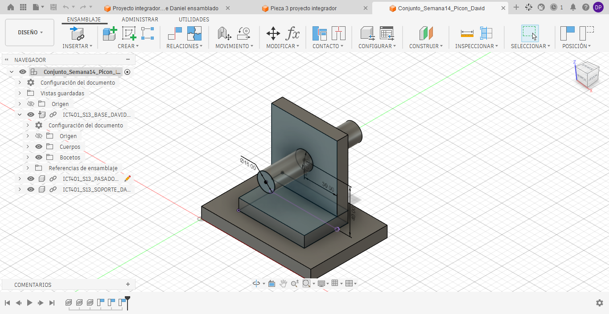
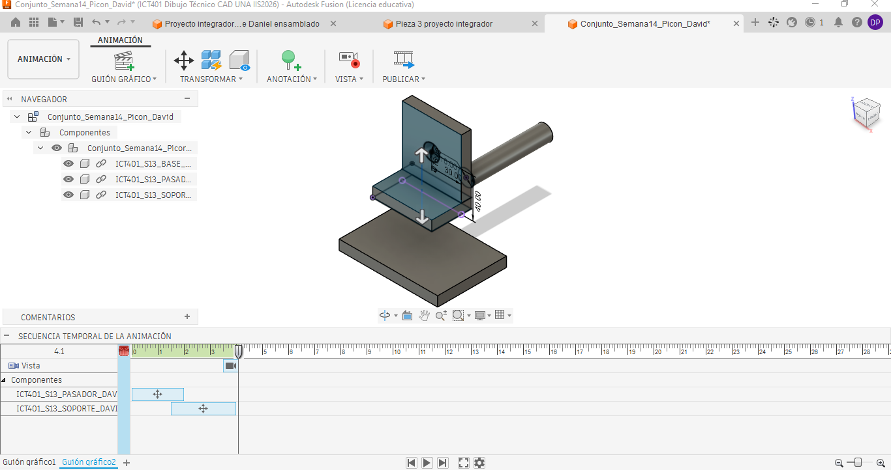

# Ficha de registro: Semana 14

**Curso:** ICT401 – Dibujo Técnico Asistido por Computadora
**Semana:** 14
**Tema:** Vista explosionada, lista de componentes y documentación de conjuntos
**Estudiante:** Picon, David
**Fecha:** 22 de octubre de 2026
**Archivo o enlace del conjunto:** `ruta/al/archivo-o-enlace`

## Propósito

Esta ficha registra las decisiones, comprobaciones, dificultades y evidencias de la documentación del conjunto. Se trabaja con el ensamblaje validado en la Semana 13. No sustituye la rúbrica oficial de la Fase 3 ni la Prueba Corta 3.

## Criterios normativos de revisión

La aplicación de estas normas es didáctica y selectiva; no constituye una certificación integral de conformidad normativa. Registre la evidencia o la limitación encontrada.

| Referencia | Criterio que se aplica | Evidencia o limitación registrada |
|---|---|---|
| INTE/ISO 128-1:2024 | La vista comunica el conjunto sin ambigüedad y conserva la identidad de sus componentes. |  |
| INTE/ISO 128-2:2023 | Contornos, ejes, líneas ocultas y líneas de trayectoria se distinguen; las trayectorias no sustituyen los contornos. |  |
| INTE/ISO 128-3:2025 / ISO 5456-2 | La orientación, las vistas y el método de proyección son coherentes. |  |
| ISO 5457 | La hoja, orientación, escala y distribución permiten leer la documentación. |  |
| INTE/ISO 7200:2008 | El cajetín o encabezado identifica conjunto, estudiante, fecha, unidades, escala y versión cuando estén disponibles. |  |
| ISO 7573 / ISO 6433 | La lista, las cantidades y los números de referencia corresponden a componentes reales. |  |
| ISO 16792:2021 | Modelo, Storyboard, Drawing, lista y evidencias corresponden a la misma versión. |  |

**Alcance:** no se aplican ISO 129-1, ISO 8015 ni ISO 2768 como requisitos de esta semana porque no se solicitan cotas funcionales ni tolerancias de fabricación.

## Producto documental integrado

La entrega debe corresponder a **un único Drawing de Fusion**. Registre aquí cómo integró las representaciones:

| Elemento obligatorio | Hoja o ubicación dentro del Drawing | Comprobado |
|---|---|:---:|
| Vistas normales `Front`, `Top` y `Right` |  | [ ] |
| Proyección de primer diedro (sistema europeo) |  | [ ] |
| Símbolo o configuración del método de proyección |  | [ ] |
| Vista explosionada del `Storyboard` |  | [ ] |
| Lista de componentes |  | [ ] |
| Globos o números de referencia |  | [ ] |
| Cajetín e identificación del conjunto |  | [ ] |
| Nombre y versión del modelo de origen |  | [ ] |

Las vistas pueden distribuirse en varias hojas, pero deben permanecer dentro del mismo Drawing. No entregue la vista explosionada y las vistas ortogonales como documentos independientes.

### Distribución de la hoja

| Control de distribución | Registro o evidencia |
|---|---|
| Vista principal utilizada como referencia |  |
| `Top` colocado debajo de `Front` |  |
| `Right` colocado a la izquierda de `Front` |  |
| Alineación y separación entre vistas ortogonales |  |
| Zona reservada para la vista explosionada |  |
| Ubicación de la lista y los globos |  |
| Cajetín libre de superposiciones |  |
| Hoja adicional utilizada dentro del mismo Drawing, si corresponde |  |

## Lección 1. Análisis del ensamblaje y planificación

### 1. Estado inicial

| Elemento | Registro |
|---|---|
| Nombre del archivo original |ICT_ENSAMBLAJE  |
| Nombre de la copia de trabajo | Conjunto_Semana14_Picon_David |
| Versión o fecha de respaldo |22/10/26  |
| Número de componentes |3  |
| Componente de referencia | Base |
| Estado inicial del ensamblaje | El conjunto se encuentra ensamblado y está formado por una base, un soporte y un pasador. Las piezas mantienen sus posiciones originales, sin aplicar separaciones. |

**Captura del conjunto antes de crear la vista explosionada:**

| Análisis de referencia | Registro |
|---|---|
| ¿Por qué se mantiene ese componente como referencia? | Se mantiene la base como referencia porque sostiene el conjunto y permite identificar la posición de las demás piezas. Si todos los componentes se desplazaran, sería más difícil comprender cómo están relacionados y cuál es su posición original. |

### 2. Componentes del conjunto

| ID | Nombre del componente | Función | Cantidad | Referencia o archivo | Observaciones |
|---|---|---|---:|---|---|
| 1 | Base | Sostener el conjunto y proporcionar estabilidad. | 1 | Archivo de base de Semana 13 | Se encuentra en la parte inferior y permanece fija durante la separación. |
| 2 | Soporte | Mantener la estructura y proporcionar el alojamiento para el pasador. | 1 | Archivo de soporte de Semana 13 | Es una pieza en forma de L ubicada sobre la base. |
| 3 | Pasador | Atravesar el alojamiento del soporte y establecer su relación de unión. | 1 | Archivo de pasador de Semana 13 | Es una pieza cilíndrica colocada horizontalmente en el soporte. |

### 3. Plan de montaje y separación

**Orden previsto de montaje y desmontaje:**

| Orden | Acción | Componente | Referencia o contacto | Dirección | Función comunicada | Comprobado |
|---:|---|---|---|---|---|:---:|
| 1 | Montar primero / retirar al final | Base | Superficie de apoyo del conjunto | Permanece fija | Proporcionar estabilidad y servir como referencia. | [si ] |
| 2 | Montar segundo / retirar segundo | Soporte | Superficie de contacto con la base | Descenso para montar y ascenso para retirar | Mostrar cómo se coloca y apoya el soporte sobre la base. | [si ] |
| 3 | Montar al final / retirar primero | Pasador | Orificio del soporte | Movimiento siguiendo su eje longitudinal | Mostrar cómo se introduce o retira el pasador del soporte. | [si ] |

| Decisión | Respuesta |
|---|---|
| Componente que se colocaría primero | La base, porque permite apoyar y posicionar las demás piezas del conjunto. |
| Componente que se retiraría al final | La base, ya que permanece como referencia durante el desmontaje. |
| Criterio utilizado para definir el orden | Se consideró la función de cada componente, sus superficies de contacto y la secuencia lógica para montar o desmontar el conjunto. |

| Orden | Componente | Dirección o referencia de separación | Razón funcional | Distancia aproximada | Comprobado |
|---:|---|---|---|---|:---:|
| 1 | Pasador | Siguiendo su eje longitudinal, hacia afuera del soporte. | Permite observar su posición y la relación con el orificio del soporte. |40mm | [ si] |
| 2 | Soporte | Verticalmente hacia arriba, alejándose de la base. | Permite visualizar las superficies de contacto entre ambas piezas. | 40mm | [si ] |
| 3 | Base | Permanece en su posición original. | Sirve como referencia para interpretar el conjunto. | 0 mm | [ si] |

| Pregunta de análisis | Respuesta |
|---|---|
| ¿Qué relación de montaje comunica la secuencia? | La secuencia permite comprender que la base sostiene el conjunto, que el soporte se coloca sobre ella y que el pasador se introduce en el alojamiento correspondiente. Al separar las piezas en el orden inverso, se puede interpretar cómo desmontar el conjunto. |
| ¿Qué dificultad o duda debe comprobarse durante la Lección 2? | Se debe comprobar que las distancias de separación permitan observar todas las piezas sin que se oculten entre sí. También será necesario verificar que el pasador se desplace siguiendo su eje y que la vista conserve una relación clara entre los componentes. |

## Lección 2. Construcción de la vista explosionada

### 4. Construcción en Fusion

**Herramienta utilizada:** `Animation > Transform > Transform Components`

**Storyboard:** S14_Vista_Explosionada

**Vista u orientación principal:** Vista isométrica que permite observar la base, el soporte y el pasador.

**Criterio para separar los componentes:** Se utilizó una separación manual basada en el orden de desmontaje. Primero se desplazó el pasador siguiendo su eje longitudinal y después se elevó el soporte, manteniendo fija la base. Las distancias se ajustaron para conservar la relación visual entre las piezas.

**Captura de la vista explosionada:**

**Captura de la posición o versión intermedia, si corresponde:**

**Decisiones realizadas en Fusion:**

| Decisión | Acción realizada | Resultado observado | Evidencia |
|---|---|---|---|
| Orientación principal | Se seleccionó una vista isométrica para observar los tres componentes. | La orientación permite identificar la base, el soporte y el pasador. | S14_E2_Vista_Explosionada.png |
| Dirección de separación | El pasador se desplazó siguiendo su eje y el soporte se elevó verticalmente. | Los movimientos permiten comprender el orden de desmontaje. | S14_E2_Vista_Explosionada.png |
| Distancia o posición | Se ajustaron las distancias de manera visual, manteniendo la base fija. | Las piezas quedan separadas sin perder su relación con el conjunto. | S14_E2_Vista_Explosionada.png |
| Captura de posición / storyboard | Se registró una posición intermedia y la vista explosionada final. | Las capturas permiten observar el proceso de separación. | S14_E2_Posicion_Intermedia.png y S14_E2_Vista_Explosionada.png |

**¿Se modificó alguna geometría?** Sí [ ] No [✓ ]

**¿Se capturó la posición o el storyboard?** Sí [✓ ] No [ ]

**¿Las líneas de trayectoria se distinguen de contornos, ejes y líneas ocultas?** Sí [✓ ] No [ ]

## Lección 3. Lista de componentes y rotulación

### 5. Lista básica de componentes

| Ítem | Identificador visible | Nombre en la lista | Cantidad | Componente correspondiente | Verificado |
|---:|---|---|---:|---|---|
| 1 |  |  |  |  | [ ] |
| 2 |  |  |  |  | [ ] |
| 3 |  |  |  |  | [ ] |
| 4 |  |  |  |  | [ ] |
| 5 |  |  |  |  | [ ] |

| Comparación | Resultado |
|---|---|
| Diferencia encontrada entre el Browser, la vista y la lista |  |
| Corrección aplicada |  |
| ¿Cada globo o número de referencia corresponde una sola vez a un componente? |  |

## Lección 4. Documentación y evaluación

### 6. Documentación del conjunto

| Criterio | Sí | No | Corrección necesaria |
|---|:---:|:---:|---|
| La vista muestra todos los componentes importantes | [ ] | [ ] |  |
| La separación sigue una lógica de montaje | [ ] | [ ] |  |
| El mismo Drawing contiene Front, Top y Right del ensamble normal | [ ] | [ ] |  |
| Las vistas ortogonales están organizadas en primer diedro europeo | [ ] | [ ] |  |
| El mismo Drawing contiene también la vista explosionada | [ ] | [ ] |  |
| `Top` está debajo de `Front` y `Right` a la izquierda de `Front` | [ ] | [ ] |  |
| Las vistas relacionadas están alineadas y suficientemente separadas | [ ] | [ ] |  |
| La vista explosionada, lista y globos tienen una zona propia | [ ] | [ ] |  |
| Ningún elemento invade el cajetín | [ ] | [ ] |  |
| Se comprobó el símbolo o configuración de primer diedro | [ ] | [ ] |  |
| Los identificadores se leen con claridad | [ ] | [ ] |  |
| La lista coincide con el modelo | [ ] | [ ] |  |
| Los contornos, ejes, ocultas y trayectorias se distinguen | [ ] | [ ] |  |
| Los globos o identificadores coinciden una sola vez con la lista | [ ] | [ ] |  |
| La hoja, escala, orientación e identificación son coherentes | [ ] | [ ] |  |
| El modelo, Storyboard y Drawing corresponden a la misma versión | [ ] | [ ] |  |
| La orientación facilita la interpretación | [ ] | [ ] |  |
| La escala permite leer textos y componentes | [ ] | [ ] |  |
| No hay superposiciones innecesarias | [ ] | [ ] |  |
| El título y los datos del conjunto están completos | [ ] | [ ] |  |
| La versión del modelo, Storyboard, Drawing y evidencias coincide | [ ] | [ ] |  |

**Archivo o captura de la documentación final:**  

| Resultado de la revisión con la rúbrica | Registro |
|---|---|
| Criterio que cumple mejor |  |
| Criterio que requiere corrección |  |
| Corrección prioritaria |  |

### 7. Problemas y correcciones

| Problema observado | Causa probable | Corrección aplicada | Evidencia |
|---|---|---|---|
|  |  |  |  |
|  |  |  |  |
|  |  |  |  |

### 8. Autoevaluación

| Pregunta | Respuesta |
|---|---|
| ¿Qué componente funcionó como referencia y por qué? |  |
| ¿Qué criterio utilizó para definir el orden de separación? |  |
| ¿Qué diferencia existe entre mover una pieza y documentar una vista explosionada? |  |
| ¿Cómo comprobó que la lista coincide con el conjunto? |  |
| ¿Qué corrección mejoró más la legibilidad de la documentación? |  |

## Cierre de las cuatro lecciones

### 9. Evidencias finales

| Evidencia | Nombre o ruta del archivo | Completa | Observaciones |
|---|---|:---:|---|
| Archivo o enlace verificable del conjunto en Fusion |  | [ ] |  |
| Vista explosionada | `evidencias/S14_E2_Vista_Explosionada.png` | [ ] |  |
| Lista básica de componentes | `evidencias/S14_E3_Lista_Componentes.png` | [ ] |  |
| Documentación del conjunto | `evidencias/S14_E4_Documentacion_Final.png` | [ ] |  |
| Captura del estado inicial | `evidencias/S14_E1_Conjunto_Inicial.png` | [ ] |  |
| Tabla y justificación del componente de referencia |  | [ ] |  |
| Plan de montaje y separación de la Lección 1 |  | [ ] |  |
| Registro de la dificultad o duda comprobada |  | [ ] |  |
| Capturas del proceso o de las correcciones |  | [ ] |  |
| Registro de la posición o storyboard | `evidencias/S14_E2_Posicion_Intermedia.png` | [ ] |  |
| Ficha completa y nombrada correctamente |  | [ ] |  |
| Revisión de la rúbrica de la Fase 3 |  | [ ] |  |

### 10. Cierre

| Cierre | Registro |
|---|---|
| Dificultad principal |  |
| Decisión técnica más importante |  |
| Pendiente antes de entregar |  |
| Nombre final de la versión entregada |  |
