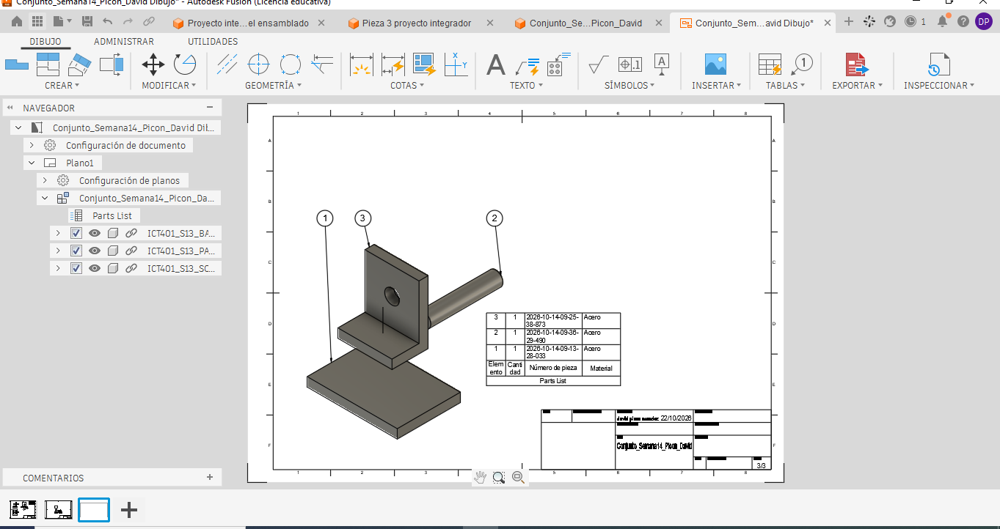
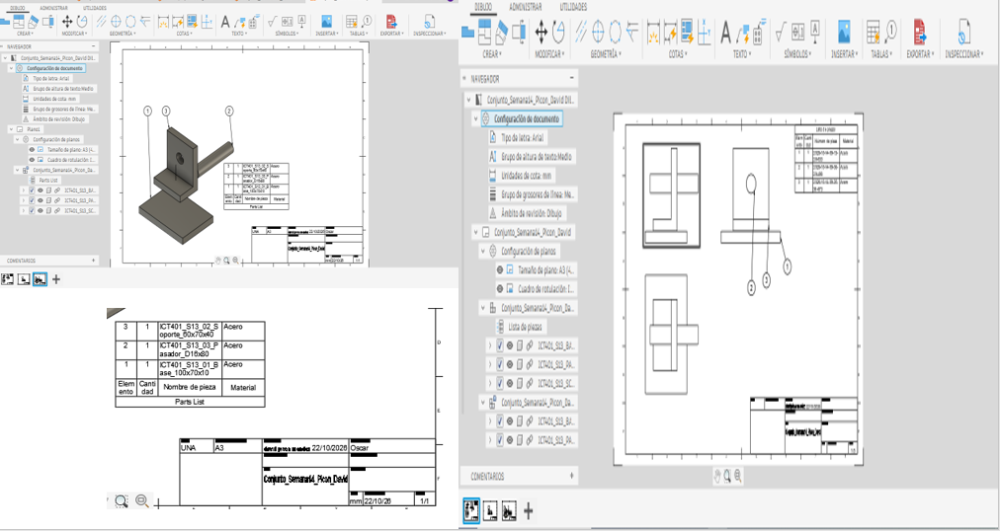

# Ficha de registro: Semana 14

**Curso:** ICT401 – Dibujo Técnico Asistido por Computadora
**Semana:** 14
**Tema:** Vista explosionada, lista de componentes y documentación de conjuntos
**Estudiante:** Picon, David
**Fecha:** 22 de octubre de 2026
**Archivo o enlace del conjunto:** `ruta/al/archivo-o-enlace`

## Propósito

Esta ficha registra las decisiones, comprobaciones, dificultades y evidencias de la documentación del conjunto. Se trabaja con el ensamblaje validado en la Semana 13. No sustituye la rúbrica oficial de la Fase 3 ni la Prueba Corta 3.

## Criterios normativos de revisión

La aplicación de estas normas es didáctica y selectiva; no constituye una certificación integral de conformidad normativa. Registre la evidencia o la limitación encontrada.

## Criterios normativos de revisión

La aplicación de estas normas es didáctica y selectiva; no constituye una certificación integral de conformidad normativa.

| Referencia | Criterio que se aplica | Evidencia o limitación registrada |
|---|---|---|
| INTE/ISO 128-1:2024 | La vista comunica el conjunto sin ambigüedad y conserva la identidad de sus componentes. | La vista explosionada permite distinguir la base, el soporte y el pasador. Los tres componentes están identificados mediante globos numerados. |
| INTE/ISO 128-2:2023 | Contornos, ejes, líneas ocultas y líneas de trayectoria se distinguen; las trayectorias no sustituyen los contornos. | Los contornos de las piezas se distinguen en el Drawing. Queda pendiente comprobar la visibilidad de las líneas de trayectoria en la documentación final. |
| INTE/ISO 128-3:2025 / ISO 5456-2 | La orientación, las vistas y el método de proyección son coherentes. | Se generaron las vistas Front, Top y Right. Está pendiente confirmar la corrección de la posición de Top y la configuración de primer diedro europeo. |
| ISO 5457 | La hoja, orientación, escala y distribución permiten leer la documentación. | Se utilizó una hoja A3 horizontal con marco y cajetín. Las vistas se distribuyeron en diferentes hojas del mismo Drawing. Falta comprobar la legibilidad del PDF exportado. |
| INTE/ISO 7200:2008 | El cajetín o encabezado identifica conjunto, estudiante, fecha, unidades, escala y versión cuando estén disponibles. | El cajetín muestra información del conjunto y la fecha de elaboración. Se debe confirmar que el autor, las unidades, la escala y la versión estén correctamente registrados. |
| ISO 7573 / ISO 6433 | La lista, las cantidades y los números de referencia corresponden a componentes reales. | La lista contiene tres componentes con cantidad 1 cada uno. El globo 1 identifica la base, el 2 el pasador y el 3 el soporte. |
| ISO 16792:2021 | Modelo, Storyboard, Drawing, lista y evidencias corresponden a la misma versión. | La documentación se realizó a partir del conjunto Conjunto_Semana14_Picon_David. Se debe confirmar que el Storyboard, el Drawing y las capturas correspondan a la última versión guardada. |

**Alcance:** no se aplican ISO 129-1, ISO 8015 ni ISO 2768 como requisitos de esta semana porque no se solicitan cotas funcionales ni tolerancias de fabricación.

## Producto documental integrado

La entrega corresponde a un único Drawing de Fusion que contiene las representaciones normales y la vista explosionada del conjunto.

| Elemento obligatorio | Hoja o ubicación dentro del Drawing | Comprobado |
|---|---|:---:|
| Vistas normales `Front`, `Top` y `Right` | Hoja 1, con las tres vistas ortogonales del ensamblaje. | [x] |
| Proyección de primer diedro (sistema europeo) | Hoja 1. Pendiente de confirmar la distribución corregida. | [ ] |
| Símbolo o configuración del método de proyección | Configuración de documento de Fusion. Pendiente de verificar First Angle (ISO). | [ ] |
| Vista explosionada del `Storyboard` | Hoja 3, representada en orientación isométrica. | [x] |
| Lista de componentes | Hoja 3, ubicada junto a la vista explosionada. | [x] |
| Globos o números de referencia | Hoja 3, alrededor de los componentes de la vista explosionada. | [x] |
| Cajetín e identificación del conjunto | Esquina inferior derecha de las hojas. Pendiente de comprobar todos los datos. | [ ] |
| Nombre y versión del modelo de origen | Conjunto_Semana14_Picon_David. Versión exacta pendiente de confirmar. | [ ] |

Las vistas normales y la explosionada se encuentran dentro del mismo Drawing, aunque estén distribuidas en hojas diferentes.

### Distribución de la hoja

| Control de distribución | Registro o evidencia |
|---|---|
| Vista principal utilizada como referencia | Se utilizó Front como vista principal para representar el ensamblaje y organizar las vistas relacionadas. |
| `Top` colocado debajo de `Front` | Pendiente de confirmar la corrección de la vista Top para que quede debajo de Front, según el primer diedro. |
| `Right` colocado a la izquierda de `Front` | La vista Right se encuentra a la izquierda de Front en la hoja de vistas ortogonales. |
| Alineación y separación entre vistas ortogonales | Las vistas están separadas para facilitar su lectura. Se debe comprobar la alineación definitiva después de corregir la ubicación de Top. |
| Zona reservada para la vista explosionada | Se utilizó una hoja independiente dentro del mismo Drawing para presentar la vista explosionada sin saturar las vistas normales. |
| Ubicación de la lista y los globos | La lista se colocó junto a la vista explosionada y los globos se distribuyeron alrededor de las tres piezas para facilitar su identificación. |
| Cajetín libre de superposiciones | El cajetín se encuentra en la esquina inferior derecha y no presenta superposiciones importantes con las vistas o la lista. |
| Hoja adicional utilizada dentro del mismo Drawing, si corresponde | Se utilizaron varias hojas dentro del mismo Drawing. La hoja 1 contiene las vistas ortogonales y la hoja 3 muestra la vista explosionada y su lista de componentes. |

## Lección 1. Análisis del ensamblaje y planificación

### 1. Estado inicial

| Elemento | Registro |
|---|---|
| Nombre del archivo original |ICT_ENSAMBLAJE  |
| Nombre de la copia de trabajo | Conjunto_Semana14_Picon_David |
| Versión o fecha de respaldo |22/10/26  |
| Número de componentes |3  |
| Componente de referencia | Base |
| Estado inicial del ensamblaje | El conjunto se encuentra ensamblado y está formado por una base, un soporte y un pasador. Las piezas mantienen sus posiciones originales, sin aplicar separaciones. |

**Captura del conjunto antes de crear la vista explosionada:**

| Análisis de referencia | Registro |
|---|---|
| ¿Por qué se mantiene ese componente como referencia? | Se mantiene la base como referencia porque sostiene el conjunto y permite identificar la posición de las demás piezas. Si todos los componentes se desplazaran, sería más difícil comprender cómo están relacionados y cuál es su posición original. |

### 2. Componentes del conjunto

| ID | Nombre del componente | Función | Cantidad | Referencia o archivo | Observaciones |
|---|---|---|---:|---|---|
| 1 | Base | Sostener el conjunto y proporcionar estabilidad. | 1 | Archivo de base de Semana 13 | Se encuentra en la parte inferior y permanece fija durante la separación. |
| 2 | Soporte | Mantener la estructura y proporcionar el alojamiento para el pasador. | 1 | Archivo de soporte de Semana 13 | Es una pieza en forma de L ubicada sobre la base. |
| 3 | Pasador | Atravesar el alojamiento del soporte y establecer su relación de unión. | 1 | Archivo de pasador de Semana 13 | Es una pieza cilíndrica colocada horizontalmente en el soporte. |

### 3. Plan de montaje y separación

**Orden previsto de montaje y desmontaje:**

| Orden | Acción | Componente | Referencia o contacto | Dirección | Función comunicada | Comprobado |
|---:|---|---|---|---|---|:---:|
| 1 | Montar primero / retirar al final | Base | Superficie de apoyo del conjunto | Permanece fija | Proporcionar estabilidad y servir como referencia. | [si ] |
| 2 | Montar segundo / retirar segundo | Soporte | Superficie de contacto con la base | Descenso para montar y ascenso para retirar | Mostrar cómo se coloca y apoya el soporte sobre la base. | [si ] |
| 3 | Montar al final / retirar primero | Pasador | Orificio del soporte | Movimiento siguiendo su eje longitudinal | Mostrar cómo se introduce o retira el pasador del soporte. | [si ] |

| Decisión | Respuesta |
|---|---|
| Componente que se colocaría primero | La base, porque permite apoyar y posicionar las demás piezas del conjunto. |
| Componente que se retiraría al final | La base, ya que permanece como referencia durante el desmontaje. |
| Criterio utilizado para definir el orden | Se consideró la función de cada componente, sus superficies de contacto y la secuencia lógica para montar o desmontar el conjunto. |

| Orden | Componente | Dirección o referencia de separación | Razón funcional | Distancia aproximada | Comprobado |
|---:|---|---|---|---|:---:|
| 1 | Pasador | Siguiendo su eje longitudinal, hacia afuera del soporte. | Permite observar su posición y la relación con el orificio del soporte. |40mm | [ si] |
| 2 | Soporte | Verticalmente hacia arriba, alejándose de la base. | Permite visualizar las superficies de contacto entre ambas piezas. | 40mm | [si ] |
| 3 | Base | Permanece en su posición original. | Sirve como referencia para interpretar el conjunto. | 0 mm | [ si] |

| Pregunta de análisis | Respuesta |
|---|---|
| ¿Qué relación de montaje comunica la secuencia? | La secuencia permite comprender que la base sostiene el conjunto, que el soporte se coloca sobre ella y que el pasador se introduce en el alojamiento correspondiente. Al separar las piezas en el orden inverso, se puede interpretar cómo desmontar el conjunto. |
| ¿Qué dificultad o duda debe comprobarse durante la Lección 2? | Se debe comprobar que las distancias de separación permitan observar todas las piezas sin que se oculten entre sí. También será necesario verificar que el pasador se desplace siguiendo su eje y que la vista conserve una relación clara entre los componentes. |

## Lección 2. Construcción de la vista explosionada

### 4. Construcción en Fusion

**Herramienta utilizada:** `Animation > Transform > Transform Components`

**Storyboard:** S14_Vista_Explosionada

**Vista u orientación principal:** Vista isométrica que permite observar la base, el soporte y el pasador.

**Criterio para separar los componentes:** Se utilizó una separación manual basada en el orden de desmontaje. Primero se desplazó el pasador siguiendo su eje longitudinal y después se elevó el soporte, manteniendo fija la base. Las distancias se ajustaron para conservar la relación visual entre las piezas.

**Captura de la vista explosionada:**

**Captura de la posición o versión intermedia, si corresponde:**

**Decisiones realizadas en Fusion:**

| Decisión | Acción realizada | Resultado observado | Evidencia |
|---|---|---|---|
| Orientación principal | Se seleccionó una vista isométrica para observar los tres componentes. | La orientación permite identificar la base, el soporte y el pasador. | S14_E2_Vista_Explosionada.png |
| Dirección de separación | El pasador se desplazó siguiendo su eje y el soporte se elevó verticalmente. | Los movimientos permiten comprender el orden de desmontaje. | S14_E2_Vista_Explosionada.png |
| Distancia o posición | Se ajustaron las distancias de manera visual, manteniendo la base fija. | Las piezas quedan separadas sin perder su relación con el conjunto. | S14_E2_Vista_Explosionada.png |
| Captura de posición / storyboard | Se registró una posición intermedia y la vista explosionada final. | Las capturas permiten observar el proceso de separación. | S14_E2_Posicion_Intermedia.png y S14_E2_Vista_Explosionada.png |

**¿Se modificó alguna geometría?** Sí [ ] No [✓ ]

**¿Se capturó la posición o el storyboard?** Sí [✓ ] No [ ]

**¿Las líneas de trayectoria se distinguen de contornos, ejes y líneas ocultas?** Sí [✓ ] No [ ]

## Lección 3. Lista de componentes y rotulación

### 5. Lista básica de componentes

| Ítem | Identificador visible | Nombre en la lista | Cantidad | Componente correspondiente | Verificado |
|---:|---|---|---:|---|---|
| 1 | 1 | Base | 1 | Base rectangular inferior del conjunto | [x] |
| 2 | 2 | Pasador | 1 | Pasador cilíndrico que atraviesa el soporte | [x] |
| 3 | 3 | Soporte | 1 | Soporte en forma de L ubicado sobre la base | [x] |

| Comparación | Resultado |
|---|---|
| Diferencia encontrada entre el Browser, la vista y la lista | Inicialmente, la lista mostraba códigos automáticos en la columna de número de pieza, lo que dificultaba identificar los componentes por su nombre. Las cantidades y los números de referencia coincidían con las tres piezas del ensamblaje. |
| Corrección aplicada | Se ajustó la lista para mostrar los nombres de los componentes de forma más clara, manteniendo sus cantidades e identificadores correspondientes. |
| ¿Cada globo o número de referencia corresponde una sola vez a un componente? | Sí. Se identificaron tres globos: el número 1 corresponde a la base, el 2 al pasador y el 3 al soporte. Cada uno señala una pieza diferente y coincide con su elemento en la lista. |

## Lección 4. Documentación y evaluación

### 6. Documentación del conjunto

| Criterio | Sí | No | Corrección necesaria |
|---|:---:|:---:|---|
| La vista muestra todos los componentes importantes | [x] | [ ] | Ninguna. Se identifican las tres piezas. |
| La separación sigue una lógica de montaje | [x] | [ ] | Mantener el orden de separación del pasador y el soporte. |
| El mismo Drawing contiene Front, Top y Right del ensamble normal | [x ] | [ ] | Comprobar las otras hojas del Drawing. |
| Las vistas ortogonales están organizadas en primer diedro europeo | [ x] | [ ] | Verificar el estándar ISO y la orientación de las vistas. |
| El mismo Drawing contiene también la vista explosionada | [x] | [ ] | Ninguna. La vista está integrada en el Drawing. |
| Top está debajo de Front y Right a la izquierda de Front | [x ] | [ ] | Comprobar la distribución de las vistas normales. |
| Las vistas relacionadas están alineadas y suficientemente separadas | [x ] | [ ] | Revisar la alineación de las vistas proyectadas. |
| La vista explosionada, lista y globos tienen una zona propia | [x] | [ ] | Ninguna superposición importante observada. |
| Ningún elemento invade el cajetín | [x] | [ ] | Mantener libre la zona del cajetín. |
| Se comprobó el símbolo o configuración de primer diedro | [x ] | [ ] | Revisar la configuración del documento. |
| Los identificadores se leen con claridad | [x] | [ ] | Ninguna. Los tres globos se distinguen. |
| La lista coincide con el modelo | [x] | [ ] | Se identificaron tres componentes con cantidad 1 cada uno. |
| Los contornos, ejes, ocultas y trayectorias se distinguen | [ x] | [ ] | Revisar las líneas de trayectoria en la vista y el PDF. |
| Los globos o identificadores coinciden una sola vez con la lista | [x] | [ ] | Ninguna. Los globos 1, 2 y 3 identifican piezas diferentes. |
| La hoja, escala, orientación e identificación son coherentes | [ x] | [ ] | Comprobar escala y datos del cajetín. |
| El modelo, Storyboard y Drawing corresponden a la misma versión | [ ] | [ ] | Confirmar la versión guardada en Fusion. |
| La orientación facilita la interpretación | [x] | [ ] | La vista isométrica permite reconocer los componentes. |
| La escala permite leer textos y componentes | [ x] | [ ] | Revisar la legibilidad en el PDF exportado. |
| No hay superposiciones innecesarias | [x] | [ ] | Mantener separados los globos, la lista y las piezas. |
| El título y los datos del conjunto están completos | [x ] | [ ] | Revisar los campos del cajetín. |
| La versión del modelo, Storyboard, Drawing y evidencias coincide | [x ] | [ ] | Comprobar que todos procedan de la versión final. |

**Archivo o captura de la documentación final:**

| Resultado de la revisión con la rúbrica | Registro |
|---|---|
| Criterio que cumple mejor | La identificación de componentes, ya que cada una de las tres piezas cuenta con un globo relacionado con la lista. |
| Criterio que requiere corrección | Pendiente de la revisión completa de las vistas, la escala y el cajetín. |
| Corrección prioritaria | Verificar que las vistas ortogonales estén organizadas en primer diedro y que la documentación sea legible en el PDF. |

### 7. Problemas y correcciones

| Problema observado | Causa probable | Corrección aplicada | Evidencia |
|---|---|---|---|
| La lista mostraba códigos automáticos en lugar de nombres claros. | La tabla utilizaba inicialmente la columna de número de pieza. | Se ajustaron las columnas para mostrar los nombres de los componentes. | S14_E3_Lista_Componentes.png |
| Las cotas y los bocetos aparecían sobre algunas piezas durante la preparación. | La visibilidad de los bocetos estaba activada. | [Confirmar si se ocultaron antes de guardar la evidencia final.] | S14_E1_Conjunto_Inicial.png / S14_E2_Vista_Explosionada.png |
| El pasador aparecía muy cerca del soporte en la primera vista explosionada. | La distancia de separación inicial era reducida. | [Confirmar si se aumentó la separación siguiendo el eje del pasador.] | S14_E2_Vista_Explosionada.png |

### 8. Autoevaluación

| Pregunta | Respuesta |
|---|---|
| ¿Qué componente funcionó como referencia y por qué? | La base funcionó como referencia porque sostiene el conjunto y permite comprender la posición de las demás piezas durante la separación. |
| ¿Qué criterio utilizó para definir el orden de separación? | Se utilizó el orden inverso al montaje. Primero se separó el pasador siguiendo su eje longitudinal y después se elevó el soporte, manteniendo fija la base. |
| ¿Qué diferencia existe entre mover una pieza y documentar una vista explosionada? | Mover una pieza solamente cambia su posición de representación. Documentar una vista explosionada implica organizar las separaciones para explicar el montaje, identificar cada componente y relacionarlo con una lista. |
| ¿Cómo comprobó que la lista coincide con el conjunto? | Se compararon los tres componentes del Browser con la vista explosionada y la lista. Se verificó que cada pieza tuviera cantidad 1 y que su número correspondiera al globo correcto. |
| ¿Qué corrección mejoró más la legibilidad de la documentación? | El ajuste de la lista de componentes para mostrar nombres claros en lugar de códigos automáticos, ya que facilita identificar cada pieza. |

## Cierre de las cuatro lecciones

### 9. Evidencias finales

| Evidencia | Nombre o ruta del archivo | Completa | Observaciones |
|---|---|:---:|---|
| Archivo o enlace verificable del conjunto en Fusion | `Conjunto_Semana14_Picon_David` | [ ] | El ensamblaje contiene la base, el soporte y el pasador. Falta confirmar que la versión final esté guardada y sea accesible. |
| Vista explosionada | `evidencias/S14_E2_Vista_Explosionada.png` | [x] | Se realizó la separación del pasador y el soporte, manteniendo fija la base. |
| Lista básica de componentes | `evidencias/S14_E3_Lista_Componentes.png` | [x] | Se identificaron tres componentes con cantidad 1 cada uno y sus respectivos globos. |
| Documentación del conjunto | `evidencias/S14_E4_Documentacion_Final.png` | [ ] | Se integraron las vistas normales y la explosionada. Falta comprobar la corrección de la distribución en primer diedro. |
| Captura del estado inicial | `evidencias/S14_E1_Conjunto_Inicial.png` | [x] | Se registró el ensamblaje original con sus tres componentes antes de realizar la separación. |
| Tabla y justificación del componente de referencia | Sección 2 de la ficha de registro | [x] | Se identificaron los componentes y se justificó la elección de la base como referencia. |
| Plan de montaje y separación de la Lección 1 | Sección 3 de la ficha de registro | [x] | Se estableció el orden de montaje y desmontaje, junto con las direcciones previstas de separación. |
| Registro de la dificultad o duda comprobada | Sección 3 de la ficha de registro | [x] | Se analizó la necesidad de establecer distancias adecuadas para separar las piezas sin perder su relación visual. |
| Capturas del proceso o de las correcciones | Evidencias de las lecciones 1, 2 y 3 | [x] | Las capturas permiten comparar el ensamblaje inicial, la separación de los componentes y su documentación. |
| Registro de la posición o storyboard | Storyboard de la vista explosionada en Fusion | [x] | Se registraron los movimientos de los componentes en Animation. La captura intermedia es opcional. |
| Ficha completa y nombrada correctamente | `S14_Registro_Picon_David.md` | [ ] | Pendiente de completar las comprobaciones finales y guardar la ficha con su nombre definitivo. |
| Revisión de la rúbrica de la Fase 3 | Rúbrica de la Fase 3 | [ ] | Pendiente de comprobar todos los criterios establecidos para la entrega. |

### 10. Cierre

| Cierre | Registro |
|---|---|
| Dificultad principal | La principal dificultad fue organizar la separación de los componentes y distribuir las vistas dentro del Drawing. Fue necesario considerar la posición del pasador y del soporte para que se pudiera comprender su relación con la base. |
| Decisión técnica más importante | La decisión más importante fue mantener la base como referencia y separar el pasador siguiendo su eje longitudinal y el soporte verticalmente. Esto permitió representar el orden de desmontaje y conservar la relación entre las piezas. |
| Pendiente antes de entregar | Comprobar la distribución de las vistas en primer diedro, revisar los datos del cajetín, verificar la versión final del modelo, exportar y revisar el PDF con todas las hojas y completar la revisión de la rúbrica. |
| Nombre final de la versión entregada | `Conjunto_Semana14_Picon_David` (versión final por confirmar en Fusion). |
